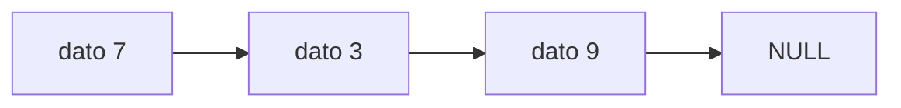

# Informe del avance

*(Borren los comentarios entre paréntesis al escribir.)*

## 1. El escenario

El escenario que escogimos fue el A, el cual trata sobre el inventario de una tienda y tenemos que hacer un programa para manejar un inventario. Los productos se identifican por código y se debe permitir modificar y consultar información, por medio de las siguientes funciones: Agregar, Eliminar, Consultar, Reponer, Listar. Con este programa el dueño de una tienda va a poder tener todo su inventario organizado para poder saber que productos tienen disponibilidad y así saber cuáles ofrecer. 

## 2. Qué guarda la estructura y qué operaciones necesita
| Operación | Qué hace | Precondición |
|---|---|---|
| Agregar | Recibe código, nombre, cantidad disponible y agrega ese producto al inventario. | Agrega el producto solo si no hay ningún producto con el mismo código. |
| Eliminar | Quita un producto usando el código. | Debe existir el producto con el código indicado para poder ser borrado. |
| Consultar | Se busca un producto con el código indicado y si existe se muestra su código, nombre y cantidad existente. | Debe existir el producto con el código indicado para poder mostrar su información. |
| Reponer | Aumenta la cantidad de productos disponibles, recibe código y la cantidad de productos que se van a adicionar. | Debe existir el producto con el código indicado para poder modificar su cantidad. |
| Listar | Muestra todos los productos existentes en el inventario y escribe un producto por línea. | No requiere que exista algún producto en el inventario. |

## 3. La estructura escogida y por qué

(Por qué esa y no la otra, en términos del orden en que entran y salen
los elementos y de lo que cuesta cada operación. Citen el texto guía:
Thareja capítulo X, o CLRS 4.ª ed. capítulo Y.)

Costos esperados, con $n$ el número de elementos:

| Operación | Tiempo (peor caso) | Espacio adicional |
|---|---|---|
| Agregar | $O(n)$: la búsqueda del código repetido domina; enlazar al final es $O(1)$ | $O(1)$ |
| Eliminar | $O(n)$ | $O(1)$ |
| Consultar | $O(n)$ | $O(1)$ |
| Reponer | $O(n)$ | $O(1)$ |
| Listar | $\Theta(n)$ | $O(1)$ |

El invariante de la estructura, como fórmula:

$$I:\quad 0 \leq n \leq \text{capacidad}$$

Un diagrama del estado de la estructura, en Mermaid:

## 4. Qué piensan medir

(Qué entrada van a variar, entre qué tamaños, y qué esperan ver.)

## 5. Casos de prueba
 
En este avance están implementadas "ELIMINAR" y "CONSULTAR" (además de "AGREGAR", que ya estaba), así que los casos prueban esas dos operaciones. En la columna «Salida obtenida» faltan las líneas "ok" de "AGREGAR", porque "agregarProducto" todavía no las imprime; "REPONER" y "LISTAR" también están pendientes. Las demás líneas coinciden con lo esperado.
 
| Caso | Entrada | Salida esperada | Salida obtenida |
|---|---|---|---|
| funcional 1 (consultar un código que está y otro que no) | 3 AGREGAR 1004512 arroz 20 CONSULTAR 1004512 CONSULTAR 999 | ok 1004512 arroz 20 no existe | 1004512 arroz 20 no existe |
| funcional 2 (eliminar el primero) | 5 AGREGAR 1 pan 10 AGREGAR 2 leche 4 ELIMINAR 1 CONSULTAR 1 CONSULTAR 2 | ok ok ok no existe 2 leche 4 | ok no existe 2 leche 4 |
| funcional 3 (eliminar el último y volver a agregar) | 7 AGREGAR 10 sal 3 AGREGAR 20 ron 4 AGREGAR 30 te 5 ELIMINAR 30 AGREGAR 40 cafe 6 CONSULTAR 40 CONSULTAR 30 | ok ok ok ok ok 40 cafe 6 no existe | ok 40 cafe 6 no existe |
| límite 1 (lista vacía y un solo elemento) | 7 ELIMINAR 5 CONSULTAR 5 AGREGAR 9 x 1 ELIMINAR 9 CONSULTAR 9 AGREGAR 8 y 2 CONSULTAR 8 | no existe no existe ok ok no existe ok 8 y 2 | no existe no existe ok no existe 8 y 2 |
| límite 2 (eliminar un nodo del medio) | 6 AGREGAR 1 a 1 AGREGAR 2 b 2 AGREGAR 3 c 3 ELIMINAR 2 CONSULTAR 2 CONSULTAR 3 | ok ok ok ok no existe 3 c 3 | ok no existe 3 c 3 |

(El caso límite es la estructura vacía, con un solo elemento, llena, o
con la clave repetida: digan cuál escogieron y por qué.)
