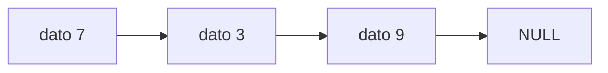

# Informe del avance

*(Borren los comentarios entre paréntesis al escribir.)*

## 1. El escenario

El escenario que escogimos fue el A, el cual trata sobre el inventario de una tienda y tenemos que hacer un programa para manejar un inventario. Los productos se identifican por código y se debe permitir modificar y consultar información, por medio de las siguientes funciones: Agregar, Eliminar, Consultar, Reponer, Listar. Con este programa el dueño de una tienda va a poder tener todo su inventario organizado para poder saber que productos tienen disponibilidad y así saber cuáles ofrecer. 

## 2. Qué guarda la estructura y qué operaciones necesita
| Operación | Qué hace | Precondición |
|---|---|---|
| Agregar | Recibe código, nombre, cantidad disponible y agrega ese producto al inventario. | Agrega el producto solo si no hay ningún producto con el mismo código. |
| Eliminar | Quita un producto usando el código. | Debe existir el producto con el código indicado para poder ser borrado. |
| Consultar | Se busca un producto con el código indicado y si existe se muestra su código, nombre y cantidad existente. | Debe existir el producto con el código indicado para poder mostrar su información. |
| Reponer | Aumenta la cantidad de productos disponibles, recibe código y la cantidad de productos que se van a adicionar. | Debe existir el producto con el código indicado para poder modificar su cantidad. |
| Listar | Muestra todos los productos existentes en el inventario y escribe un producto por línea. | No requiere que exista algún producto en el inventario. |

## 3. La estructura escogida y por qué

(Por qué esa y no la otra, en términos del orden en que entran y salen
los elementos y de lo que cuesta cada operación. Citen el texto guía:
Thareja capítulo X, o CLRS 4.ª ed. capítulo Y.)

Costos esperados, con $n$ el número de elementos:

| Operación | Tiempo | Espacio |
|---|---|---|
|  | $O(1)$ | $O(1)$ |

El invariante de la estructura, como fórmula:

$$I:\quad 0 \leq n \leq \text{capacidad}$$

Un diagrama del estado de la estructura, en Mermaid:

## 4. Qué piensan medir

(Qué entrada van a variar, entre qué tamaños, y qué esperan ver.)

## 5. Casos de prueba

| Caso | Entrada | Salida esperada | Salida obtenida |
|---|---|---|---|
| funcional 1 |  |  |  |
| funcional 2 |  |  |  |
| funcional 3 |  |  |  |
| límite |  |  |  |

(El caso límite es la estructura vacía, con un solo elemento, llena, o
con la clave repetida: digan cuál escogieron y por qué.)
