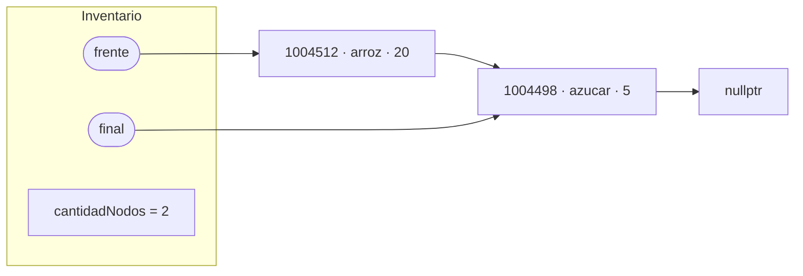

# Informe del avance

## 1. El escenario

El escenario escogido es el **A**, el cual trata sobre el inventario de una tienda. El programa administra un catálogo de artículos identificados por un código entero único, un nombre (palabra sin espacios) y una cantidad disponible. A partir de órdenes leídas desde la entrada estándar, el sistema permite modificar y consultar el estado del inventario mediante cinco operaciones: `AGREGAR`, `ELIMINAR`, `CONSULTAR`, `REPONER` y `LISTAR`. Con esta herramienta, el encargado de la tienda puede mantener el registro actualizado de sus existencias, verificar disponibilidad inmediata y reabastecer productos de forma controlada.

## 2. Qué guarda la estructura y qué operaciones necesita

Cada nodo de la estructura almacena la información completa de un artículo (`codigo`, `nombre` y `cantidadDisponible`) junto con el apuntador `siguienteProducto` hacia el siguiente elemento de la secuencia.

| Operación | Qué hace | Precondición |
|---|---|---|
| `AGREGAR` | Recibe código, nombre y cantidad disponible; inserta el producto al final del inventario y escribe `ok`. | No debe existir otro producto con el mismo código; si existe, escribe `repetido` y no lo inserta. |
| `ELIMINAR` | Busca un producto por su código, lo remueve del inventario, libera su memoria y escribe `ok`. | Debe existir el producto con el código indicado; si no existe, escribe `no existe`. |
| `CONSULTAR` | Busca un producto por su código y muestra `codigo nombre cantidad`. | Debe existir el producto con el código indicado; si no existe, escribe `no existe`. |
| `REPONER` | Recibe un código y una cantidad a adicionar, incrementa las unidades disponibles del producto y escribe `ok`. | Debe existir el producto con el código indicado; si no existe, escribe `no existe`. |
| `LISTAR` | Recorre todo el inventario y muestra un producto por línea en formato `codigo nombre cantidad`. | No requiere que existan productos previos (si está vacía, no escribe líneas). |

## 3. ¿Cómo es la estructura?

Para este avance se implementó una **lista enlazada simple** encapsulada dentro de la clase `Inventario`, con punteros al primer nodo (`frente`), al último nodo (`final`) y un contador de elementos (`cantidadNodos`).

### 3.1 Justificación de la estructura

En primer lugar, se analizó el patrón de acceso de las operaciones:

- **Descarte de pilas y colas:** En una pila (LIFO) solo se accede al último elemento insertado y en una cola (FIFO) únicamente al primero. En un inventario los clientes y el encargado consultan, reponen o eliminan cualquier artículo según su código sin importar el momento en que ingresó, por lo que restringir el acceso a los extremos no resuelve el problema.
- **Lista enlazada simple frente a arreglo:** Un arreglo requiere reservar un bloque contiguo de capacidad fija o realizar copias completas de tamaño $O(n)$ cada vez que se llena. Además, eliminar un elemento intermedio en un arreglo obliga a desplazar hasta $n - 1$ elementos posteriores. En la lista enlazada simple cada producto se reserva dinámicamente con `new` al momento de llegar, y la eliminación solo requiere redirigir el apuntador del nodo anterior. Gracias al puntero `final`, insertar un nuevo artículo al final se realiza en $O(1)$ una vez verificada su unicidad.
- **Lista enlazada simple frente a lista doble y lista ordenada:** Una lista doblemente enlazada añade un segundo apuntador por nodo que aumenta el consumo de memoria sin mejorar el costo de búsqueda por código, pues igualmente hay que recorrer desde el inicio. Una lista ordenada obligaría a buscar la posición lexicográfica o numérica en cada inserción, y el enunciado no exige que `LISTAR` entregue los productos ordenados.
- **Preparación para la entrega final:** Encapsular la lista dentro de `Inventario` permite reutilizar esta misma estructura lineal como cubeta de encadenamiento en la tabla hash de la entrega final, manteniendo exactamente las mismas firmas públicas de los métodos.

> **Cita del texto guía:**  
> De acuerdo con Cormen et al. (*Introduction to Algorithms*, 4.ª ed., Capítulo 10: *Elementary Data Structures*, Sección 10.2: *Linked lists*) y Reema Thareja (*Data Structures Using C*, 2.ª ed., Capítulo 6: *Linked Lists*), la búsqueda de una clave en una lista enlazada simple sin ordenamiento requiere examinar secuencialmente los nodos desde la cabeza, con un tiempo en el peor caso de $\Theta(n)$, mientras que la inserción y el desenlace de un nodo una vez ubicada su posición toman tiempo constante $O(1)$.

### 3.2 Invariante de la estructura

La lista enlazada no tiene una capacidad máxima fija; su integridad estructural se mantiene bajo las siguientes condiciones: `frente` apunta siempre al primer nodo de la secuencia, `final` apunta al último nodo, `cantidadNodos` registra el número exacto de nodos actualmente enlazados ($n \geq 0$), y el último nodo apunta a `nullptr`. Formalmente:

$$I:\quad (n = 0 \iff frente = \text{nullptr} \land final = \text{nullptr}) \;\land\; (n > 0 \implies frente \neq \text{nullptr} \land final \neq \text{nullptr} \land final.\text{siguienteProducto} = \text{nullptr}) \;\land\; \text{cantidadNodos} = n$$

### 3.3 Diagrama del estado de la estructura

Estado de la lista tras agregar dos productos (`1004512 arroz 20` y `1004498 azucar 5`):

### 3.4 Costo operativo

Sea $n$ el número de productos almacenados en el inventario. En el **peor caso** (el código buscado está en el último nodo o no pertenece a la lista):

| Operación | Tiempo (peor caso) | Espacio adicional | Razón |
|---|---|---|---|
| `AGREGAR` | $O(n)$ | $O(1)$ | Verifica primero si el código ya existe recorriendo los $n$ nodos ($O(n)$) y luego enlaza el nuevo nodo usando `final` en $O(1)$. |
| `ELIMINAR` | $O(n)$ | $O(1)$ | Recorre hasta $n$ nodos manteniendo el nodo anterior para reenlazar apuntadores y liberar el nodo con `delete`. |
| `CONSULTAR` | $O(n)$ | $O(1)$ | Recorre secuencialmente la lista hasta encontrar el código o alcanzar `nullptr`. |
| `REPONER` | $O(n)$ | $O(1)$ | Realiza búsqueda lineal hasta encontrar el nodo y suma la cantidad en $O(1)$. |
| `LISTAR` | $\Theta(n)$ | $O(1)$ | Visita exactamente los $n$ nodos de la lista tanto en el mejor como en el peor caso. |

**Análisis lineal y testigos:** Revisar un nodo durante el recorrido (comparar su código y avanzar al siguiente apuntador) toma una constante $a$ de operaciones elementales, y las instrucciones fuera del ciclo toman una constante $b$. En el peor caso se examinan los $n$ nodos:

$$T(n) = a\,n + b$$

Para todo $n \geq 1$, se cumple $a\,n + b \leq (a + b)\,n$. Por lo tanto, $T(n) \in O(n)$ con testigos $c = a + b$ y $n_0 = 1$.

**Espacio:** La estructura ocupa $\Theta(n)$ en memoria dinámica (un objeto `Nodo` por cada artículo registrado). El espacio auxiliar de todas las operaciones es $O(1)$, ya que únicamente emplean un número fijo de punteros locales (`actual`, `anterior`). El método `eliminarProducto` libera con `delete` cada nodo eliminado individualmente y el destructor `~Inventario` recorre y libera todos los nodos restantes al finalizar la ejecución, evitando fugas de memoria.

## 4. Qué piensan medir

En la entrega final se medirá **el tiempo de ejecución de `CONSULTAR` en función del número de artículos $n$**, comparando tres implementaciones sobre exactamente las mismas secuencias de entrada:

1. **Lista enlazada simple** (implementada desde cero en este avance, costo $O(n)$).
2. **Tabla hash con encadenamiento** (implementada desde cero para la entrega final, donde cada cubeta es una lista enlazada simple y la función hash opera sobre la clave entera).
3. **`std::map`** (contenedor de la biblioteca estándar de C++, utilizado exclusivamente como curva de referencia, con costo $O(\log n)$).

**Variables y escenarios experimentales:**

- **Tamaños de entrada ($n$):** Se evaluarán al menos cinco tamaños crecientes de inventario, duplicando la cantidad de productos en cada paso ($n \in \{1000,\ 2000,\ 4000,\ 8000,\ 16000,\ 32000\}$) para observar la tasa de crecimiento del tiempo.
- **Tamaños de tabla hash ($M$):** Se probarán tres configuraciones de cubetas: un tamaño pequeño fijo ($M = 101$), un tamaño cercano al número de artículos ($M \approx n$) y un número primo mayor que $n$.
- **Escenario de colisión total:** Se construirá un cuarto conjunto de claves (múltiplos de $M$ bajo $h(c) = c \bmod M$) diseñado para que todos los artículos caigan en la misma cubeta.

**Protocolo y resultados esperados:** Se poblará cada estructura con $n$ artículos (sin incluir el tiempo de inserción en la medición) y se ejecutará un lote fijo de consultas exitosas y fallidas midiendo con `std::chrono::steady_clock`. Se registrará la mediana de múltiples repeticiones en `datos/mediciones.csv` y se graficará con Mermaid (`xychart-beta`). Se espera que la lista enlazada crezca linealmente ($T(n) \approx a\,n + b$), que `std::map` crezca logarítmicamente, que la tabla hash con $M \approx n$ o primo mayor mantenga tiempo casi constante $O(1 + \alpha)$, y que en el caso de colisión total la tabla hash degrade a $\Theta(n)$ igualando la pendiente de la lista enlazada.

**Orden de salida de `LISTAR`:** En la lista enlazada los artículos se imprimen en orden cronológico de inserción; en la tabla hash salen agrupados por índice de cubeta y dentro de cada cubeta según la política de inserción; y en `std::map` salen ordenados ascendentemente por código. Para garantizar exactamente la misma salida en las tres estructuras, sería necesario ordenar los resultados por código antes de imprimirlos o almacenar un identificador secuencial de llegada.

## 5. Casos de prueba

Todas las operaciones (`AGREGAR`, `ELIMINAR`, `CONSULTAR`, `REPONER` y `LISTAR`) se encuentran implementadas y verificadas. Los archivos de prueba en la carpeta `datos/` (`funcionales.in` / `funcionales.out` y `limites.in` / `limites.out`) se ejecutan automáticamente desde `codigo/` mediante `make pruebas`.

| Caso | Entrada | Salida esperada | Salida obtenida |
|---|---|---|---|
| **Funcional 1** (`datos/funcionales.in`: flujo completo de agregar, consultar, reponer, listar y eliminar) | 9 AGREGAR 10045 arroz 20 CONSULTAR 10045 CONSULTAR 1 REPONER 10045 5 CONSULTAR 10045 AGREGAR 10046 leche 6 LISTAR ELIMINAR 10045 LISTAR | ok 10045 arroz 20 no existe ok 10045 arroz 25 ok 10045 arroz 25 10046 leche 6 ok 10046 leche 6 | ok 10045 arroz 20 no existe ok 10045 arroz 25 ok 10045 arroz 25 10046 leche 6 ok 10046 leche 6 |
| **Funcional 2** (eliminar el primer nodo de la lista) | 5 AGREGAR 1 pan 10 AGREGAR 2 leche 4 ELIMINAR 1 CONSULTAR 1 CONSULTAR 2 | ok ok ok no existe 2 leche 4 | ok ok ok no existe 2 leche 4 |
| **Funcional 3** (eliminar el último nodo y volver a agregar) | 7 AGREGAR 10 sal 3 AGREGAR 20 ron 4 AGREGAR 30 te 5 ELIMINAR 30 AGREGAR 40 cafe 6 CONSULTAR 40 CONSULTAR 30 | ok ok ok ok ok 40 cafe 6 no existe | ok ok ok ok ok 40 cafe 6 no existe |
| **Límite 1** (`datos/limites.in`: lista vacía, clave repetida, un solo elemento y nodo intermedio) | 13 CONSULTAR 1 ELIMINAR 1 LISTAR AGREGAR 1 sal 2 AGREGAR 1 arroz 9 CONSULTAR 1 ELIMINAR 1 CONSULTAR 1 AGREGAR 2 pan 1 AGREGAR 3 galletas 2 AGREGAR 4 jugo 3 ELIMINAR 3 LISTAR | no existe no existe ok repetido 1 sal 2 ok no existe ok ok ok ok 2 pan 1 4 jugo 3 | no existe no existe ok repetido 1 sal 2 ok no existe ok ok ok ok 2 pan 1 4 jugo 3 |

### Justificación de los casos límite seleccionados

- **Estructura vacía (`CONSULTAR`, `ELIMINAR` y `LISTAR` iniciales en `limites.in`):** Verifica que las operaciones manejen correctamente `frente == nullptr` sin desreferenciar punteros nulos.
- **Clave repetida (`AGREGAR 1 arroz 9` tras `AGREGAR 1 sal 2`):** Comprueba que se respete la unicidad de códigos, respondiendo `repetido` y conservando intactos los datos del artículo original.
- **Transición de un solo elemento y eliminación intermedia:** Valida que `frente` y `final` se restablezcan en `nullptr` al borrar el único nodo existente y que se mantenga la continuidad de la lista al borrar el nodo intermedio (`ELIMINAR 3`).
