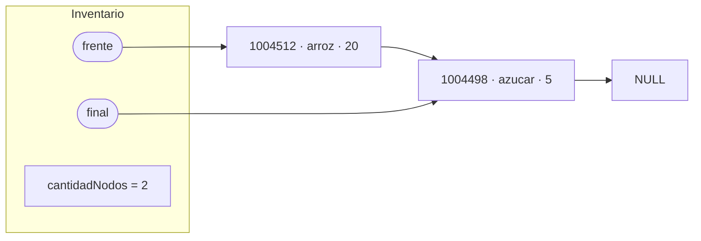

# Informe del avance

*(Borren los comentarios entre paréntesis al escribir.)*

## 1. El escenario

El escenario que escogimos fue el A, el cual trata sobre el inventario de una tienda y tenemos que hacer un programa para manejar un inventario. Los productos se identifican por código y se debe permitir modificar y consultar información, por medio de las siguientes funciones: Agregar, Eliminar, Consultar, Reponer, Listar. Con este programa el dueño de una tienda va a poder tener todo su inventario organizado para poder saber que productos tienen disponibilidad y así saber cuáles ofrecer. 

## 2. Qué guarda la estructura y qué operaciones necesita
| Operación | Qué hace | Precondición |
|---|---|---|
| Agregar | Recibe código, nombre, cantidad disponible y agrega ese producto al inventario. | Agrega el producto solo si no hay ningún producto con el mismo código. |
| Eliminar | Quita un producto usando el código. | Debe existir el producto con el código indicado para poder ser borrado. |
| Consultar | Se busca un producto con el código indicado y si existe se muestra su código, nombre y cantidad existente. | Debe existir el producto con el código indicado para poder mostrar su información. |
| Reponer | Aumenta la cantidad de productos disponibles, recibe código y la cantidad de productos que se van a adicionar. | Debe existir el producto con el código indicado para poder modificar su cantidad. |
| Listar | Muestra todos los productos existentes en el inventario y escribe un producto por línea. | No requiere que exista algún producto en el inventario. |

## 3. ¿Como es la estructura?

(Por qué esa y no la otra, en términos del orden en que entran y salen
los elementos y de lo que cuesta cada operación. Citen el texto guía:
Thareja capítulo X, o CLRS 4.ª ed. capítulo Y.)

Costos esperados, con $n$ el número de elementos:

| Operación | Tiempo (peor caso) | Espacio adicional |
|---|---|---|
| Agregar | $O(n)$: la búsqueda del código repetido domina; enlazar al final es $O(1)$ | $O(1)$ |
| Eliminar | $O(n)$ | $O(1)$ |
| Consultar | $O(n)$ | $O(1)$ |
| Reponer | $O(n)$ | $O(1)$ |
| Listar | $\Theta(n)$ | $O(1)$ |

El invariante de la estructura, como fórmula:

$$I:\quad 0 \leq n \leq \text{capacidad}$$

Un diagrama del estado de la estructura, en Mermaid:

## 3.2 Juztificacion

Primero miramos el orden en que entran y salen los productos. 
En una pila sale primero el último que entró, y en una cola sale primero el primero que entró. En el inventario no pasa eso: el dueño pide un producto por su código, sin importar cuándo lo agregó, y puede ser cualquiera. Por eso ni la pila ni la cola nos sirven, porque solo dejan sacar por un extremo. Necesitamos una estructura donde se pueda buscar, cambiar y quitar un producto de cualquier posición. Entre las estructuras lineales comparamos un arreglo con una lista enlazada, y elegimos la lista por estas razones:
 
1. **No sabemos cuántos productos habrá.** Un arreglo necesita un tamaño fijo, 
o hay que copiarlo todo a uno más grande cuando se llena. La lista pide memoria con `new` solo para cada producto que llega, así que ocupa justo lo que necesita.

2. **Eliminar es barato una vez que se encontró el producto.** En un arreglo, 
al quitar un producto hay que correr todos los que vienen después (hasta $n-1$ movimientos). 
En la lista solo se cambia un apuntador: el nodo anterior pasa a apuntar al siguiente del que se borra.

3. **Agregar al final no recorre nada.** Gracias a `final`, enlazar un nodo nuevo al final cuesta $O(1)$.

4. **Así lo pide el enunciado.** Para el avance se pide una lista enlazada simple con búsqueda lineal por código, y en la entrega final cada cubeta de la tabla hash será una de estas listas. Además, como la lista queda dentro de la clase `Inventario`, quien la usa solo llama a las operaciones: en la entrega final la tabla hash podrá ofrecer las mismas operaciones con las mismas firmas, y el programa que mide usará una u otra sin cambiar.
Lo que perdemos: una lista no tiene índices. Para llegar a un producto hay que pasar por todos los anteriores, y por eso la búsqueda por código es lineal. Además, cada nodo guarda un apuntador extra. Para un inventario pequeño o mediano es aceptable; la tabla hash de la entrega final es la que va a mejorar las búsquedas.
 
También descartamos otras dos opciones. La lista doblemente enlazada gasta un apuntador más por nodo y ayuda poco, porque de todas formas hay que buscar el código para llegar al nodo. La lista ordenada por código obligaría a recorrerla hasta encontrar el lugar de cada producto nuevo, y el enunciado no pide ningún orden para `LISTAR`.

## 3.3 Costo operativo

Usamos $n$ para el número de productos y miramos el **peor caso**: el producto buscado está de último, o no está.
 
| Operación | Tiempo (peor caso) | Espacio adicional |
|---|---|---|
| Agregar | $O(n)$: la búsqueda del código repetido domina; enlazar al final es $O(1)$ | $O(1)$ |
| Eliminar | $O(n)$ | $O(1)$ |
| Consultar | $O(n)$ | $O(1)$ |
| Reponer | $O(n)$ | $O(1)$ |
| Listar | $\Theta(n)$ | $O(1)$ |
 
**Por qué es lineal.** Para buscar un código se revisan los nodos uno por uno. Revisar un nodo (comparar el código y pasar al siguiente) cuesta siempre lo mismo, digamos $a$ pasos, y lo que se hace fuera del ciclo cuesta otra cantidad fija $b$. En el peor caso se revisan los $n$ nodos:
 
$$T(n) = a\,n + b$$
 
Para $n \geq 1$ se cumple $T(n) \leq (a+b)\,n$. Entonces, con los testigos $c = a+b$ y $n_0 = 1$, 
tenemos $T(n) \in O(n)$.
 
`Eliminar`, `Consultar` y `Reponer` recorren la lista hasta encontrar el código, 
y después hacen una cantidad fija de trabajo (cambiar apuntadores, imprimir o sumar), 
así que cuestan $O(n)$. `Agregar` primero busca si el código ya existe ($O(n)$) y después enlaza al final ($O(1)$), 
por eso su costo total es $O(n)$. `Listar` siempre recorre todos los nodos, ni más ni menos, 
así que tarda $\Theta(n)$ tanto en el mejor como en el peor caso.
 
**Espacio.** El espacio adicional es $O(1)$ porque solo se usan unas pocas variables auxiliares (`anterior`, `actual`, `siguiente`) y su cantidad no depende de $n$. 
La estructura completa ocupa $\Theta(n)$, un nodo por producto. 
`eliminarProducto` libera con `delete` el nodo que quita y `destruirLista` libera todos los que quedan al terminar el programa, para que no haya fugas de memoria.

## 4. Qué piensan medir

En la entrega final vamos a medir **el tiempo de `CONSULTAR` contra el número de artículos $n$**, y a comparar tres cosas con la misma entrada: la lista enlazada de este avance, la tabla hash con encadenamiento (donde cada cubeta es una lista como la de este avance) y `std::map` como referencia, que se usa solo para medir y no por dentro de nuestras estructuras. En este avance solo dejamos planeada la medición.
 
**Qué entrada vamos a variar**
 
- **El número de artículos:** $n \in \{1000,\ 2000,\ 4000,\ 8000,\ 16000,\ 32000\}$, con códigos distintos. Son seis tamaños que se duplican, para ver si el tiempo también se duplica (el proyecto pide al menos cinco).
- **El tamaño $M$ de la tabla hash:** tres valores, uno pequeño (por ejemplo $M = 101$), uno cercano al número de artículos ($M \approx n$) y un primo mayor que $n$ (por ejemplo, el primer primo después de $2n$).
- **Un cuarto juego de códigos** escogido para que todos caigan en la misma cubeta (por ejemplo, múltiplos de $M$ si la función hash es $c \bmod M$).
**Cómo lo vamos a medir.** Primero se construye la estructura con $n$ productos (el tiempo de `AGREGAR` no entra en la medición) y después se mide un bloque fijo de consultas, con códigos que existen y con códigos que no existen. El tiempo se toma con `std::chrono::steady_clock`, se repite varias veces y se usa la mediana. Todo se corre en la misma máquina, con el mismo compilador y las mismas banderas. Los tiempos se guardan en `datos/mediciones.csv` y se reportan en una tabla y en una gráfica de Mermaid (`xychart-beta`).
 
**Qué esperamos ver.** Con $\alpha = n/M$ el número promedio de nodos por cubeta:
 
- **Lista enlazada:** el tiempo crece en línea recta con $n$, $T(n) \approx a\,n + b$, así que al duplicar $n$ el tiempo se duplica. Es lo que predice el costo $O(n)$ de la sección 3.3.
- **Tabla hash con $M$ pequeño:** cada cubeta tiene unos $n/M$ nodos, así que el tiempo sigue creciendo con $n$, pero mucho más despacio que en la lista.
- **Tabla hash con $M \approx n$ o con un primo mayor:** $\alpha$ queda cerca de 1 o por debajo, y el tiempo debería quedar casi constante, $O(1+\alpha)$ en promedio (CLRS, capítulo 11).
- **Cuarto juego de códigos:** todos los códigos caen en una sola cubeta, y la tabla se comporta como la lista, $\Theta(n)$.
- **`std::map`:** crece como $\log n$, mucho más despacio que la lista.
Si lo medido no coincide con lo que predijimos, lo vamos a explicar en el informe final.
 
**El orden de `LISTAR`.** En la lista sale en el orden de llegada, 
porque siempre se agrega al final. En la tabla hash sale cubeta por cubeta, y dentro de cada cubeta en orden de llegada, así que puede salir distinto. En `std::map` sale de menor a mayor código. 
Si queremos el mismo orden en las estructuras, hay que ordenar la salida con el mismo criterio en todas (por ejemplo, por código antes de escribir) o guardar un número de llegada en cada producto.

## 5. Casos de prueba
 
En este avance están implementadas "ELIMINAR" y "CONSULTAR" (además de "AGREGAR", que ya estaba), así que los casos prueban esas dos operaciones. En la columna «Salida obtenida» faltan las líneas "ok" de "AGREGAR", porque "agregarProducto" todavía no las imprime; "REPONER" y "LISTAR" también están pendientes. Las demás líneas coinciden con lo esperado.
 
| Caso | Entrada | Salida esperada | Salida obtenida |
|---|---|---|---|
| funcional 1 (consultar un código que está y otro que no) | 3 AGREGAR 1004512 arroz 20 CONSULTAR 1004512 CONSULTAR 999 | ok 1004512 arroz 20 no existe | 1004512 arroz 20 no existe |
| funcional 2 (eliminar el primero) | 5 AGREGAR 1 pan 10 AGREGAR 2 leche 4 ELIMINAR 1 CONSULTAR 1 CONSULTAR 2 | ok ok ok no existe 2 leche 4 | ok no existe 2 leche 4 |
| funcional 3 (eliminar el último y volver a agregar) | 7 AGREGAR 10 sal 3 AGREGAR 20 ron 4 AGREGAR 30 te 5 ELIMINAR 30 AGREGAR 40 cafe 6 CONSULTAR 40 CONSULTAR 30 | ok ok ok ok ok 40 cafe 6 no existe | ok 40 cafe 6 no existe |
| límite 1 (lista vacía y un solo elemento) | 7 ELIMINAR 5 CONSULTAR 5 AGREGAR 9 x 1 ELIMINAR 9 CONSULTAR 9 AGREGAR 8 y 2 CONSULTAR 8 | no existe no existe ok ok no existe ok 8 y 2 | no existe no existe ok no existe 8 y 2 |
| límite 2 (eliminar un nodo del medio) | 6 AGREGAR 1 a 1 AGREGAR 2 b 2 AGREGAR 3 c 3 ELIMINAR 2 CONSULTAR 2 CONSULTAR 3 | ok ok ok ok no existe 3 c 3 | ok no existe 3 c 3 |

(El caso límite es la estructura vacía, con un solo elemento, llena, o
con la clave repetida: digan cuál escogieron y por qué.)

En este caso, como límite decidimos la estructura vacía, ya que nos permite observar cómo se comporta el inventario cuando no hay productos. Principalmente las opciones de CONSULTAR, LISTAR y ELIMINAR, ya que estas tiene que manejar correctamente cuando la lista está vacía y así no acceder a información basura o memoria que no se le pidió.
