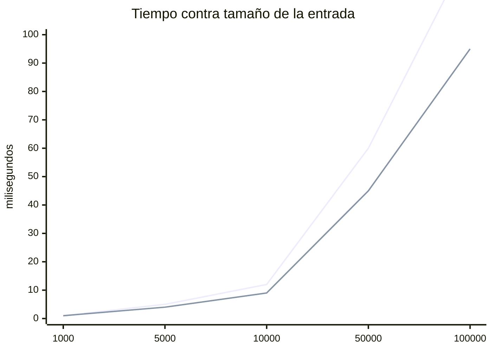

# Informe final

*(Parte del informe del avance, corregido con la realimentación.)*

## 1. El escenario y el modelado

(Del avance, corregido.)

## 2. Las dos estructuras

(Qué operaciones expone cada una y por qué la interfaz es la misma.)

## 3. Análisis formal de complejidad

Una demostración por operación no trivial, en cuatro partes:

**Teorema.** (Enunciado con la cota.)

**Demostración.** Se procede de forma directa. (La estrategia.)

*Desarrollo.* (La cadena de desigualdades, con la justificación de cada
paso.)

$$T(n) = \ldots \leq c \cdot n^2 \quad \text{para todo } n \geq k$$

*Conclusión.* Por lo tanto, $T(n) \in O(n^2)$ con testigos $c = \ldots$
y $k = \ldots$

### Resumen de costos
 
| Operación | Desde cero (tabla hash) | De la biblioteca (`std::map`) | Por qué |
|---|---|---|---|
| `AGREGAR` | Peor caso $O(n)$; promedio $O(1+\alpha)$ | $O(\log n)$ | La tabla busca en una cubeta e inserta al frente en $O(1)$; el árbol balanceado tiene altura $O(\log n)$. |
| `ELIMINAR` | Peor caso $O(n)$; promedio $O(1+\alpha)$ | $O(\log n)$ | La tabla recorre la cubeta dos veces como máximo; el árbol busca y rebalancea. |
| `CONSULTAR` | Peor caso $O(n)$; promedio $O(1+\alpha)$ | $O(\log n)$ | Todo depende de la longitud de la cubeta: $\alpha$ en promedio y hasta $n$ si todos colisionan. |
| `REPONER` | Peor caso $O(n)$; promedio $O(1+\alpha)$ | $O(\log n)$ | Búsqueda más una suma constante. |
| `LISTAR` | $\Theta(M + n)$ | $\Theta(n)$ | La tabla visita las $M$ cubetas aunque estén vacías; el recorrido en orden del árbol visita cada nodo una vez. |
 
Para comparar: la lista enlazada simple del avance costaba $O(n)$ en las cuatro operaciones de búsqueda y $\Theta(n)$ en `LISTAR`. La tabla con $M \geq n$ mejora la búsqueda en promedio, pero con colisión total vuelve a ese costo.

## 4. Experimentos

Máquina, compilador y banderas con que se midió; cómo se generaron las
entradas; cuántas repeticiones por tamaño.

| $n$ | desde cero (ms) | biblioteca (ms) |
|---|---|---|
| 1000 |  |  |
| 5000 |  |  |
| 10000 |  |  |
| 50000 |  |  |
| 100000 |  |  |

## 5. Lo medido contra lo predicho

(¿Coincide la curva con la cota? Donde no coincida, expliquen por qué:
la constante oculta, la memoria caché, el crecimiento del vector.)

## 6. Conclusiones

(Cuál estructura conviene para este escenario y bajo qué condiciones
cambiaría la respuesta.)
