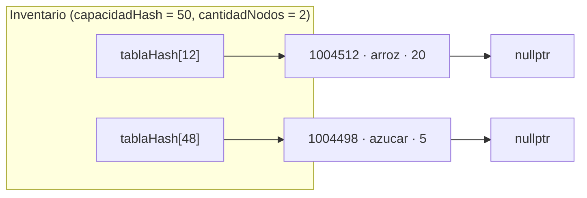

# Informe final
 
*Parte del informe del avance, corregido con la realimentación.*
 
## 1. El escenario y el modelado
 
### 1.1 El escenario
 
El escenario escogido es el **A**, el cual trata sobre el inventario de una tienda. El programa administra un catálogo de artículos identificados por un código entero único, un nombre (palabra sin espacios, de a lo sumo 200 caracteres) y una cantidad disponible. A partir de órdenes leídas desde la entrada estándar, el sistema permite modificar y consultar el estado del inventario mediante cinco operaciones: `AGREGAR`, `ELIMINAR`, `CONSULTAR`, `REPONER` y `LISTAR`. Con esta herramienta, el encargado de la tienda puede mantener el registro actualizado de sus existencias, verificar disponibilidad inmediata y reabastecer productos de forma controlada.
 
### 1.2 Qué guarda la estructura y qué operaciones necesita
 
Cada nodo almacena la información completa de un artículo (`codigo`, `nombre` y `cantidadDisponible`) junto con el apuntador `siguienteProducto` hacia el siguiente elemento de su cubeta.
 
| Operación | Qué hace | Precondición |
|---|---|---|
| `AGREGAR` | Recibe código, nombre y cantidad disponible; inserta el producto al frente de la cubeta que le corresponde y escribe `ok`. | No debe existir otro producto con el mismo código; si existe, escribe `repetido` y no lo inserta. |
| `ELIMINAR` | Busca un producto por su código, lo remueve del inventario, libera su memoria y escribe `ok`. | Debe existir el producto con el código indicado; si no existe, escribe `no existe`. |
| `CONSULTAR` | Busca un producto por su código y muestra `codigo nombre cantidad`. | Debe existir el producto con el código indicado; si no existe, escribe `no existe`. |
| `REPONER` | Recibe un código y una cantidad a adicionar, incrementa las unidades disponibles del producto y escribe `ok`. | Debe existir el producto con el código indicado; si no existe, escribe `no existe`. |
| `LISTAR` | Recorre todo el inventario y muestra un producto por línea en formato `codigo nombre cantidad`. | No requiere que existan productos previos (si está vacío, no escribe líneas). |
 
### 1.3 ¿Cómo es la estructura?
 
La clase `Inventario` encapsula una **tabla hash con encadenamiento**: un arreglo de $M$ apuntadores (`tablaHash`, de tamaño `capacidadHash` $= M$) y un contador de elementos (`cantidadNodos`). Cada casilla apunta al primer nodo de una **lista enlazada simple**, que es la estructura lineal del avance y ahora cumple el papel de cubeta. La función hash es $h(c) = c \bmod M$, corregida para que nunca sea negativa.
 
**Cambios respecto al avance.**
 
- La lista única (`frente`, `final`, `cantidadNodos`) pasó a ser una lista por cubeta. Ya no se necesita `final`: cada artículo nuevo se inserta **al frente** de su cubeta, lo cual también cuesta $O(1)$ una vez verificada su unicidad.
- El nombre se guarda como `std::string`. La lectura admite hasta 200 caracteres y, si la palabra es más larga, descarta el resto antes de leer la cantidad, de modo que las órdenes siguientes se procesan con normalidad. Además se revisa lo que devuelve cada `scanf`.
- Las cuatro operaciones que buscan por código (`AGREGAR`, `ELIMINAR`, `CONSULTAR` y `REPONER`) usan una sola función privada, `buscarProductoHash`, que devuelve el nodo o `nullptr`. Antes cada una repetía el mismo ciclo.
- Las firmas públicas de los métodos se mantienen idénticas a las del avance, de modo que la misma lista sirve como cubeta sin cambiar a quien usa la clase.
#### Justificación de la estructura
 
En primer lugar, se analizó el patrón de acceso de las operaciones:
 
- **Descarte de pilas y colas:** En una pila (LIFO) solo se accede al último elemento insertado y en una cola (FIFO) únicamente al primero. En un inventario los clientes y el encargado consultan, reponen o eliminan cualquier artículo según su código sin importar el momento en que ingresó, por lo que restringir el acceso a los extremos no resuelve el problema.
- **Lista enlazada simple frente a arreglo:** Un arreglo requiere reservar un bloque contiguo de capacidad fija o realizar copias completas de tamaño $O(n)$ cada vez que se llena. Además, eliminar un elemento intermedio en un arreglo obliga a desplazar hasta $n - 1$ elementos posteriores. En la lista enlazada simple cada producto se reserva dinámicamente con `new` al momento de llegar, y la eliminación solo requiere redirigir el apuntador del nodo anterior. Por eso se conserva como cubeta.
- **Lista enlazada simple frente a lista doble y lista ordenada:** Una lista doblemente enlazada añade un segundo apuntador por nodo que aumenta el consumo de memoria sin mejorar el costo de búsqueda por código, pues igualmente hay que recorrer desde el inicio. Una lista ordenada obligaría a buscar la posición numérica en cada inserción, y el enunciado no exige que `LISTAR` entregue los productos ordenados.
- **Una sola lista frente a una tabla hash:** Con una única lista, toda búsqueda por código cuesta $\Theta(n)$ en el peor caso. La tabla hash reparte los artículos entre $M$ cubetas con la función $h$, de modo que cada búsqueda recorre solo una cubeta, de longitud promedio $\alpha = n/M$. Como casi todas las operaciones del escenario son búsquedas por código, esa es la mejora que importa.
> **Cita del texto guía:**  
> De acuerdo con Cormen et al. (*Introduction to Algorithms*, 4.ª ed., Capítulo 10: *Elementary Data Structures*, Sección 10.2: *Linked lists*) y Reema Thareja (*Data Structures Using C*, 2.ª ed., Capítulo 6: *Linked Lists*), la búsqueda de una clave en una lista enlazada simple sin ordenamiento requiere examinar secuencialmente los nodos desde la cabeza, con un tiempo en el peor caso de $\Theta(n)$, mientras que la inserción y el desenlace de un nodo una vez ubicada su posición toman tiempo constante $O(1)$. Cormen et al. (Capítulo 11: *Hash Tables*, Sección 11.2: *Hash tables*) muestran además que, al resolver colisiones por encadenamiento y suponer hash uniforme simple, la búsqueda toma tiempo esperado $\Theta(1 + \alpha)$, con $\alpha = n/M$.
 
### 1.4 Invariante de la estructura
 
Lo que la estructura mantiene, dicho en palabras: cada casilla `tablaHash[j]` apunta al primer nodo de la cubeta $j$, o es `nullptr` si esa cubeta está vacía; el último nodo de cada cubeta apunta a `nullptr`; cada nodo está en la cubeta que le corresponde por su código, es decir, en la casilla $h(c)$; no hay dos nodos con el mismo código; y `cantidadNodos` cuenta exactamente los nodos enlazados entre todas las cubetas. Formalmente, con $L_j$ la lista de la cubeta $j$ y $n \geq 0$ el número de artículos:
 
$$I:\quad \bigl(\forall j \in [0, M-1],\ \forall x \in L_j:\ h(x.\text{codigo}) = j\bigr) \;\land\; \bigl(\text{los códigos son distintos}\bigr) \;\land\; \Bigl(\sum_{j=0}^{M-1} |L_j| = \text{cantidadNodos} = n\Bigr)$$
 
Dentro de cada cubeta se conserva la condición de la lista simple del avance: `tablaHash[j]` es el primer nodo y el último apunta a `nullptr`.
 
### 1.5 Diagrama del estado de la estructura
 
Estado del inventario real ($M = 50$) tras agregar `1004512 arroz 20` y `1004498 azucar 5`. Como $1004512 \bmod 50 = 12$ y $1004498 \bmod 50 = 48$, cada uno cae en una cubeta distinta; las demás casillas valen `nullptr`:
 

 
## 2. Las dos estructuras
 
Se comparan dos implementaciones sobre exactamente las mismas secuencias de entrada: la **tabla hash con encadenamiento**, implementada desde cero (clase `Inventario` de `principal.cpp`), y **`std::map`**, contenedor de la biblioteca estándar de C++ ordenado por código, utilizado como curva de referencia.
 
### 2.1 Qué operaciones expone cada una y por qué la interfaz es la misma
 
Las dos exponen los mismos métodos públicos, con las mismas firmas, así que `main` no cambia al pasar de una a otra:
 
```cpp
void agregarProducto(Nodo* nuevo);
void eliminarProducto(int codigo);
void consultarProducto(int codigo);
void reponerProducto(int codigo, int cantidadAgregar);
void listarProductos();
```
 
La interfaz es la misma porque el enunciado fija el comportamiento observable (qué se escribe en cada caso) y no la representación interna: como `Inventario` esconde cómo se guardan los nodos, el programa que mide puede usar una u otra sin cambios. Lo que varía es cómo se ubica el artículo por su código:
 
| Operación | Tabla hash (desde cero) | `std::map` (biblioteca) |
|---|---|---|
| `AGREGAR` | `buscarProductoHash`; si no está, inserta al frente de la cubeta $h(c)$. | `find(c)`; si no está, `insert`. |
| `ELIMINAR` | Busca el nodo; si es el primero de la cubeta ajusta la casilla, si no busca el anterior y lo reenlaza; `delete`. | `find(c)` y `erase`. |
| `CONSULTAR` | Recorre la cubeta $h(c)$ hasta hallar $c$ o `nullptr`. | `find(c)`. |
| `REPONER` | Misma búsqueda; suma a `cantidadDisponible`. | `find(c)`; suma a la cantidad. |
| `LISTAR` | Recorre las cubetas $0, 1, \dots, M-1$ y cada lista. | Recorre el árbol en orden. |
 
### 2.2 Orden de salida de `LISTAR`
 
El orden **no** es el mismo en las estructuras:
 
- **Lista enlazada del avance** (inserción al final): orden cronológico de llegada.
- **Tabla hash:** por índice de cubeta, de $0$ a $M-1$; dentro de cada cubeta, del artículo insertado más recientemente al más antiguo (porque se inserta al frente).
- **`std::map`:** ascendente por código.
Ejemplo verificado ejecutando `principal.cpp` con $M = 50$. Se insertaron, en este orden, `1004512`, `1004498`, `50` y `100`; los códigos `50` y `100` caen ambos en la cubeta $0$:
 
| Posición | Tabla hash ($M=50$) | `std::map` |
|---|---|---|
| 1 | `100 b 2` (cubeta 0, el más reciente) | `50 a 1` |
| 2 | `50 a 1` (cubeta 0) | `100 b 2` |
| 3 | `1004512 arroz 20` (cubeta 12) | `1004498 azucar 5` |
| 4 | `1004498 azucar 5` (cubeta 48) | `1004512 arroz 20` |
 
**Qué hacer para obtener el mismo orden.** Hay que fijar un orden canónico y que ambas estructuras lo produzcan:
 
- *Orden ascendente por código* (el natural de `std::map`): la tabla hash copia los $n$ artículos a un vector, lo ordena por código y lo imprime. Cuesta $\Theta(M + n\log n)$ en lugar de $\Theta(M + n)$.
- *Orden de llegada:* cada artículo guarda un número de secuencia creciente y `LISTAR` ordena por ese número antes de imprimir. Cuesta el mismo $\Theta(n\log n)$ y añade un entero por nodo.
### 2.3 Casos de prueba
 
Todas las operaciones (`AGREGAR`, `ELIMINAR`, `CONSULTAR`, `REPONER` y `LISTAR`) están implementadas. Los archivos de `datos/` (`funcionales.in` / `funcionales.out` y `limites.in` / `limites.out`) se ejecutan desde `codigo/` con `make pruebas`. La columna *Salida obtenida* es la que imprime el programa compilado con la tabla hash (con `-Wall -Wextra` no produce advertencias, y con AddressSanitizer y UBSan no reporta fugas ni comportamiento indefinido).
 
| Caso | Entrada | Salida esperada | Salida obtenida |
|---|---|---|---|
| **Funcional 1** (`datos/funcionales.in`: flujo completo de agregar, consultar, reponer, listar y eliminar) | 9<br>AGREGAR 10045 arroz 20<br>CONSULTAR 10045<br>CONSULTAR 1<br>REPONER 10045 5<br>CONSULTAR 10045<br>AGREGAR 10046 leche 6<br>LISTAR<br>ELIMINAR 10045<br>LISTAR | ok<br>10045 arroz 20<br>no existe<br>ok<br>10045 arroz 25<br>ok<br>10045 arroz 25<br>10046 leche 6<br>ok<br>10046 leche 6 | ok<br>10045 arroz 20<br>no existe<br>ok<br>10045 arroz 25<br>ok<br>10045 arroz 25<br>10046 leche 6<br>ok<br>10046 leche 6 |
| **Funcional 2** (eliminar el primer nodo) | 5<br>AGREGAR 1 pan 10<br>AGREGAR 2 leche 4<br>ELIMINAR 1<br>CONSULTAR 1<br>CONSULTAR 2 | ok<br>ok<br>ok<br>no existe<br>2 leche 4 | ok<br>ok<br>ok<br>no existe<br>2 leche 4 |
| **Funcional 3** (eliminar el último nodo y volver a agregar) | 7<br>AGREGAR 10 sal 3<br>AGREGAR 20 ron 4<br>AGREGAR 30 te 5<br>ELIMINAR 30<br>AGREGAR 40 cafe 6<br>CONSULTAR 40<br>CONSULTAR 30 | ok<br>ok<br>ok<br>ok<br>ok<br>40 cafe 6<br>no existe | ok<br>ok<br>ok<br>ok<br>ok<br>40 cafe 6<br>no existe |
| **Límite 1** (`datos/limites.in`: vacío, clave repetida, un solo elemento y nodo intermedio) | 13<br>CONSULTAR 1<br>ELIMINAR 1<br>LISTAR<br>AGREGAR 1 sal 2<br>AGREGAR 1 arroz 9<br>CONSULTAR 1<br>ELIMINAR 1<br>CONSULTAR 1<br>AGREGAR 2 pan 1<br>AGREGAR 3 galletas 2<br>AGREGAR 4 jugo 3<br>ELIMINAR 3<br>LISTAR | no existe<br>no existe<br>ok<br>repetido<br>1 sal 2<br>ok<br>no existe<br>ok<br>ok<br>ok<br>ok<br>2 pan 1<br>4 jugo 3 | no existe<br>no existe<br>ok<br>repetido<br>1 sal 2<br>ok<br>no existe<br>ok<br>ok<br>ok<br>ok<br>2 pan 1<br>4 jugo 3 |
| **Cubeta compartida** ($M = 50$: `5`, `55` y `105` caen en la cubeta 5; eliminar el del medio y luego el último; reponer y eliminar un código inexistente) | 9<br>AGREGAR 5 a 1<br>AGREGAR 55 b 1<br>AGREGAR 105 c 1<br>ELIMINAR 55<br>LISTAR<br>ELIMINAR 5<br>LISTAR<br>REPONER 999 3<br>ELIMINAR 999 | ok<br>ok<br>ok<br>ok<br>105 c 1<br>5 a 1<br>ok<br>105 c 1<br>no existe<br>no existe | ok<br>ok<br>ok<br>ok<br>105 c 1<br>5 a 1<br>ok<br>105 c 1<br>no existe<br>no existe |
| **Nombre de 26 caracteres** (la lectura debe consumir la palabra completa y responder las órdenes siguientes) | 4<br>AGREGAR 1 nnnnnnnnnnnnnnnnnnnnnnnnnn 7<br>CONSULTAR 1<br>CONSULTAR 2<br>LISTAR | ok<br>1 nnnnnnnnnnnnnnnnnnnnnnnnnn 7<br>no existe<br>1 nnnnnnnnnnnnnnnnnnnnnnnnnn 7 | ok<br>1 nnnnnnnnnnnnnnnnnnnnnnnnnn 7<br>no existe<br>1 nnnnnnnnnnnnnnnnnnnnnnnnnn 7 |
 
### Justificación de los casos seleccionados
 
- **Estructura vacía (`CONSULTAR`, `ELIMINAR` y `LISTAR` iniciales de Límite 1):** verifica que las operaciones manejen cubetas en `nullptr` sin desreferenciar punteros nulos.
- **Clave repetida (`AGREGAR 1 arroz 9` tras `AGREGAR 1 sal 2`):** comprueba que se respete la unicidad de códigos, respondiendo `repetido` y conservando intactos los datos del artículo original.
- **Eliminación en cabeza, medio y final de una cubeta (Funcional 2, Límite 1 y Cubeta compartida):** valida que se actualice la casilla de la tabla al borrar el primer nodo y que se conserve la continuidad de la cubeta al borrar uno intermedio o el último.
- **Orden dentro de una cubeta (Cubeta compartida):** confirma que, por insertar al frente, `LISTAR` muestra primero el artículo más reciente (`105` antes que `5`).
- **Nombre largo:** comprueba que el sobrante de una palabra larga no queda en la entrada y no desordena las órdenes siguientes.
## 3. Análisis formal de complejidad
 
**Convenciones.** $n$ es el número de artículos, $M$ el número de cubetas y $\ell_j$ la longitud de la cubeta $j$ (así que $\sum_j \ell_j = n$). Revisar un nodo durante el recorrido (comparar su código y avanzar al siguiente apuntador) toma una constante $a$ de operaciones elementales, y las instrucciones fuera del ciclo toman una constante $b$; las demás constantes $a', p, q$ se definen donde se usan. Como el nombre mide a lo sumo 200 caracteres, escribir una línea cuesta tiempo constante.
 
### Teorema 1 (búsqueda; sirve para `CONSULTAR`, `REPONER` y la verificación de `AGREGAR`)
 
**Teorema.** En el peor caso, `buscarProductoHash` toma tiempo $O(n)$, sin importar el valor de $M$. La cota es ajustada: existe una familia de entradas con $\Theta(n)$.
 
**Demostración.** Se procede de forma directa. El costo es el de calcular $h$ y visitar los nodos de **una sola** cubeta, que no puede tener más de $n$ nodos.
 
*Desarrollo.* Si el código cae en la cubeta $j$, se visitan a lo sumo $\ell_j$ nodos, y $\ell_j \leq n$ porque una cubeta es un subconjunto de los artículos. Entonces:
 
$$T(n) = a\,\ell_j + b \;\leq\; a\,n + b \;\leq\; (a + b)\,n \quad \text{para todo } n \geq 1$$
 
*Conclusión.* Por lo tanto, $T(n) \in O(n)$ con testigos $c = a + b$ y $k = 1$.
 
*Ajustada.* Si los $n$ códigos son múltiplos de $M$ (cuarto juego de claves del experimento), todos caen en la cubeta $0$ y una búsqueda fallida visita los $n$ nodos: $T(n) = a\,n + b \geq a\,n$, de modo que $T(n) \in \Omega(n)$ y por tanto $T(n) \in \Theta(n)$. Es exactamente el análisis lineal de la lista del avance: con colisión total la tabla degrada a la lista. $\blacksquare$
 
### Teorema 2 (búsqueda, caso promedio)
 
**Teorema.** Bajo la hipótesis de hash uniforme simple (cada código cae en cualquiera de las $M$ cubetas con probabilidad $1/M$, de forma independiente), la búsqueda fallida toma tiempo esperado $O(1 + \alpha)$, con $\alpha = n/M$. Si $M \geq n$, el tiempo esperado es $O(1)$.
 
**Demostración.** Se procede de forma directa, con la linealidad de la esperanza sobre la longitud de la cubeta.
 
*Desarrollo.* Para un código $c$ ausente, cada uno de los $n$ artículos cae en la cubeta $h(c)$ con probabilidad $1/M$, así que $E[\ell_{h(c)}] = n \cdot \tfrac{1}{M} = \alpha$. Entonces:
 
$$E[T] = b + a \cdot E[\ell_{h(c)}] = b + a\,\alpha \;\leq\; \max(a, b)\,(1 + \alpha) \quad \text{para todo } n \geq 0$$
 
*Conclusión.* Por lo tanto, $E[T] \in O(1 + \alpha)$ con testigos $c = \max(a, b)$ y $k = 0$. Si $M \geq n$ entonces $\alpha \leq 1$ y $E[T] \leq 2\max(a,b)$, es decir $O(1)$. $\blacksquare$
 
Con $M$ pequeño y fijo (por ejemplo $M = 101$) y $n$ creciente, $\alpha = n/101$ crece con $n$: el tiempo sigue siendo lineal, solo que con pendiente unas $101$ veces menor que la de la lista.
 
### Teorema 3 (`ELIMINAR`)
 
**Teorema.** En el peor caso, `eliminarProducto` toma tiempo $O(n)$.
 
**Demostración.** Se procede de forma directa: son dos recorridos de la misma cubeta, la búsqueda del nodo y la búsqueda de su anterior, más trabajo constante para reenlazar y liberar.
 
*Desarrollo.* La búsqueda visita a lo sumo $\ell_j$ nodos, con costo $a$ cada uno. Si el nodo no es el primero de la cubeta, el ciclo que busca al anterior visita a lo sumo $\ell_j - 1$ nodos, con costo $a'$ cada uno. El reenlace, el `delete` y la escritura de `ok` cuestan una constante $b$. Para todo $n \geq 1$:
 
$$T(n) \leq a\,\ell_j + a'(\ell_j - 1) + b \;\leq\; (a + a')\,n + b \;\leq\; (a + a' + b)\,n \quad \text{para todo } n \geq 1$$
 
*Conclusión.* Por lo tanto, $T(n) \in O(n)$ con testigos $c = a + a' + b$ y $k = 1$. En el caso promedio, con las hipótesis del Teorema 2, es $O(1 + \alpha)$. $\blacksquare$
 
### Teorema 4 (`LISTAR`)
 
**Teorema.** `listarProductos` toma tiempo $\Theta(M + n)$ en todos los casos.
 
**Demostración.** Se procede de forma directa: el ciclo externo recorre las $M$ cubetas y los ciclos internos visitan, entre todos, exactamente los $n$ nodos.
 
*Desarrollo.* Sea $p$ el costo de procesar una cubeta (leer su cabeza y comprobarla) y $q$ el costo de escribir un nodo y avanzar. Cada nodo pertenece a una sola cubeta, así que se visita exactamente una vez:
 
$$T(n, M) = p\,M + q\,n + b$$
 
Como $M \geq 1$, se tiene $M + n \geq 1$ y
 
$$\min(p, q)\,(M + n) \;\leq\; T(n, M) \;\leq\; (p + q + b)\,(M + n) \quad \text{para todo } n \geq 0$$
 
*Conclusión.* Por lo tanto, $T \in \Theta(M + n)$ con testigos $c_1 = \min(p,q)$, $c_2 = p + q + b$ y $k = 0$. No hay mejor ni peor caso: el costo no depende de cómo se repartan los artículos entre las cubetas. (En la lista del avance, $M$ no existe y el costo es $\Theta(n)$.) $\blacksquare$
 
### Operaciones que no necesitan demostración aparte
 
- `AGREGAR` = búsqueda (Teorema 1) + inserción al frente de la cubeta en $O(1)$; su cota es la de la búsqueda.
- `REPONER` = búsqueda (Teorema 1) + una suma en $O(1)$.
- El constructor cuesta $\Theta(M)$ (inicializa $M$ apuntadores).
**Espacio.** La estructura ocupa $\Theta(M + n)$ en memoria dinámica: $M$ apuntadores de la tabla más un objeto `Nodo` por cada artículo registrado. El espacio auxiliar de todas las operaciones es $O(1)$, ya que únicamente emplean un número fijo de punteros locales (`actual`, `productoAnterior`). El método `eliminarProducto` libera con `delete` cada nodo eliminado individualmente, y el destructor `~Inventario` recorre las cubetas, libera todos los nodos restantes y luego el arreglo con `delete[]`, en tiempo $\Theta(M + n)$, evitando fugas de memoria.
 
### Resumen de costos
 
| Operación | Desde cero (tabla hash) | De la biblioteca (`std::map`) | Por qué |
|---|---|---|---|
| `AGREGAR` | Peor caso $O(n)$; promedio $O(1+\alpha)$ | $O(\log n)$ | La tabla busca en una cubeta e inserta al frente en $O(1)$; el árbol balanceado tiene altura $O(\log n)$. |
| `ELIMINAR` | Peor caso $O(n)$; promedio $O(1+\alpha)$ | $O(\log n)$ | La tabla recorre la cubeta dos veces como máximo; el árbol busca y rebalancea. |
| `CONSULTAR` | Peor caso $O(n)$; promedio $O(1+\alpha)$ | $O(\log n)$ | Todo depende de la longitud de la cubeta: $\alpha$ en promedio y hasta $n$ si todos colisionan. |
| `REPONER` | Peor caso $O(n)$; promedio $O(1+\alpha)$ | $O(\log n)$ | Búsqueda más una suma constante. |
| `LISTAR` | $\Theta(M + n)$ | $\Theta(n)$ | La tabla visita las $M$ cubetas aunque estén vacías; el recorrido en orden del árbol visita cada nodo una vez. |
 
Para comparar: la lista enlazada simple del avance costaba $O(n)$ en las cuatro operaciones de búsqueda y $\Theta(n)$ en `LISTAR`. La tabla con $M \geq n$ mejora la búsqueda en promedio, pero con colisión total vuelve a ese costo.

## 4. Experimentos

## 5. Lo medido contra lo predicho

## 6. Conclusiones
